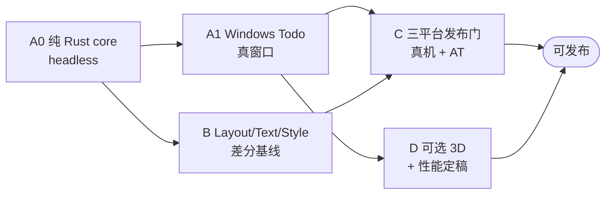

# 验收 Gate：A0–D

Gate 是**可判定的里程碑**，不是"代码能 build"。每条判据只回答三件事：**通过判据是什么、需要什么证据、现在到哪一步**。

状态词只用 `SPEC` / `PROBE` / `OPEN` / `WITHDRAWN`。`VERIFIED` 只在 `evidence/` 层声明，本文件以 `EVID-VAL-xx` 引用，不自行断言"已验证"。

## 0. 三条反作弊规则

1. **0 tests 的 target 不算通过。** 根 package 当前 0 tests（`EVID-VAL-17`）；`exit 0` 只说明能构建。
2. **缺 runner = blocked，不复制结果。** Windows/Linux/AT 的结果不能由 macOS 主机推导；一台机器的绿色不能跨平台复用。
3. **判据必须能在干净机器上复跑。** 仓库外临时夹具、只在作者机器存在的脚本、口头结论都不构成 Gate 证据。

blocked 的记录形状（机器可读，写入 `artifacts/desktop/<os>-<display>-<adapter>/results.json`）：

```json
{
  "gate": "C",
  "criterion": "SPEC-GATE-C-01",
  "status": "blocked",
  "prerequisite": "windows-runner | linux-wayland-session | at-spi-client",
  "host": {"os": "...", "display": "...", "adapter": "..."},
  "commit": "...",
  "artifact_hash": "...",
  "notes": "未执行，不是失败"
}
```

`blocked` 既不是 pass 也不是 fail；把它写成 pass 是发布门的一级事故。

## 1. Gate 总表

| Gate | 目标 | 方法 | 阻塞合并 | 当前状态 |
|---|---|---|---|---|
| **A0** | 纯 Rust core + Todo reducer（headless，无宏/无窗口/无 GPU） | 编译期 + 运行时 trace | 是 | `OPEN`（`A0-01`、`A0-03`…`A0-06` 已达 `PROBE`，证据见 `EVID-VAL-20`…`-24`、`-27`；`A0-02` 与 `A0-07`…`A0-11` 仍 `OPEN`） |
| **A1** | 单 Windows Todo 真实窗口 | 真机 + 运行时 | 是（针对"桌面可用"宣称） | `OPEN` |
| **B** | layout / text / style 差分基线 | 运行时 golden | 是（针对样式与文字能力宣称） | `SPEC`（有 3 条 style 探针，见 `EVID-VAL-12`） |
| **C** | 三平台真实发布门 | 真机 + AT + package | 发布阻断 | `OPEN`（缺 runner） |
| **D** | 可选 3D 与性能定稿 | 运行时 + 真机 | 发布阻断（一旦宣称 3D） | `OPEN` |

依赖关系（B 与 A1 可在 A0 之后并行；C 必须在 A1 与 B 之后）：



## 2. Gate A0 — 纯 Rust core + Todo reducer

**范围**：不使用 proc macro、winit 或 GPU。最小 `crates/core` + `crates/app`，空 Store → root Owner → draft/filter/query memo → fake native View，单线程 headless 跑事务并输出 trace。
**入口**：`cargo run -p zenui-app --example todolist_headless --locked`（可运行，见 `EVID-VAL-20`）。
**场景顺序**：empty → insert A/B/C → toggle B → Active → reorder → delete focused → bulk clear → invalid id rollback → 下一次 insert 成功。

| ID | 通过判据（MUST） | 需要的证据 | 当前状态 |
|---|---|---|---|
| `SPEC-GATE-A0-01` | `crates/core`、`crates/app` 存在；上述命令可跑并输出确定性 trace（query/mount/materialization/edge/geometry/focus/caret/I-O 计数） | 仓库内可复跑的命令 + trace 快照 | `PROBE`（`EVID-VAL-20` 命令与 trace、`EVID-VAL-21` workspace 测试；gate 整体仍 `OPEN`） |
| `SPEC-GATE-A0-02` | 每个 UI 行 mount 只读一次 owned title；Copy handle 不携带 `String`；`read_once` 返回 `Result` | trybuild：`#[derive(Copy)] struct{String}` 必须 E0204；运行时 read 计数恰为 1；`String::with` 借读合法、拥有式 get 不编译 | `OPEN`（仓库内 fixture 已建立：`EVID-VAL-41` 的 E0204/E0599 UI 快照、`EVID-VAL-36` 的 mount 读计数；语言层另见 `EVID-VAL-18`） |
| `SPEC-GATE-A0-03` | `{runtime_id, slot, generation}` 分离；旧 handle/旧 generation 只得到一条 `InvalidHandle`，无默认值、无旧值 patch | 运行时：slot 复用后派发旧 click/读/写；跨 runtime handle 拒绝；类型层 ViewId/RowKey/LayoutNodeId 互传必须编译失败（判据原文的 `TodoId`/`TaffyId` 在现行代码中对应 `RowKey`/`LayoutNodeId`） | `PROBE`（`EVID-VAL-23` 的 stale 复用与跨 runtime 夹具、`EVID-VAL-41` 的 6 条 E0308 UI 快照；原 6 条 doctest 已按 ADR-0021 迁移；gate 整体仍 `OPEN`） |
| `SPEC-GATE-A0-04` | 最外层 batch 只提交一次；嵌套 batch 不外泄中间值 | instrumented committed-read 记录中间值与提交次数 | `PROBE`（`EVID-VAL-23`：内层读到自身未提交写、发布恰好一次且为外层值；旧反例 `EVID-VAL-08` 的场景已由该夹具覆盖） |
| `SPEC-GATE-A0-05` | Memo 拓扑到稳定值才发布；diamond/长链无 glitch；`WriteDuringCompute`、cycle 是领域错误 | 运行时 trace：发布值 + 每 epoch 可观测次数；错误可恢复 | `PROBE`（`EVID-VAL-24`：diamond/长链、compute 相位写返回 `ValueError::Phase` 并锁存致命、自读环返回 `Fatal::GraphCycle`；**多节点环无夹具**） |
| `SPEC-GATE-A0-06` | TreeCommit 先完整 preflight（key/topology/focus/IME/resource/`LayoutMap`）到 staging，再一次 swap；失败后 native 树、id 映射、focus、geometry epoch 与上次提交完全一致 | 注入 `InvalidGeneration`/`DuplicateKey` 后逐字段比对；随后一笔干净事务可正常提交（phase guard 已复位） | `PROBE`（`EVID-VAL-23` 的回滚夹具 + `EVID-VAL-24` 的 `LayoutMap`/preflight 单测；native 树与 IME 在 A0 不存在，属 Gate A1） |
| `SPEC-GATE-A0-07` | query cache 单接线：`rows(filter)` 求值登记 membership + 实际读取的 `(row, completed)` 反向边；命中只标脏 cache；`Memo<RowSet>` 只追踪 cache revision | `(store_epoch, filter)` 每 epoch query_eval/cache_build/id_materialize 各恰 +1；两个消费者 String clones = 0 | `OPEN` |
| `SPEC-GATE-A0-08` | 空态由独立 counter/membership 索引派生：`row_visits = 0`、`RowSet materialization = 0` | 1000 行 + 三 filter 切换时计数不增长；用 `collect()` 实现 `is_empty` 必须判红 | `OPEN` |
| `SPEC-GATE-A0-09` | For 强制 key；same-owner reorder 保留 ViewId/generation/owner/subscriptions/caret/focus；duplicate key 在任何 patch 前拒绝 | reorder 后 unmount/setup = 0；重复 key 抛领域错误且旧视图不变 | `OPEN` |
| `SPEC-GATE-A0-10` | 结构 mutation 前记 `FocusRemovalIntent`；commit 后仅在目标仍受影响时按 同 kind next → prev → 可聚焦 input → toolbar；批量 Clear 只结算一次 | reducer trace：每次焦点转移的原因与后继；用户中途转移焦点时 intent 被取消 | `OPEN` |
| `SPEC-GATE-A0-11` | 1000+ 交错 mount/unmount/filter churn 后 nodes/edges/live owner/caches 回到基线；**空 subscriber bucket 不计活跃订阅** | 压力测试前后 live graph 计数；回收关系而非 `Arc` size | `OPEN` |

> `SPEC-GATE-A0-06` 的映射项在 A0 由 core 内零依赖的私有 `LayoutMap` 承担并真实参与 preflight；`taffy::NodeId` 适配器归 Gate B（[ADR-0017](../decisions/adr-0017-p2-runtime-authority-and-transaction-shape.md)）。

## 3. Gate A1 — 单 Windows Todo 真实窗口

**范围**：一个 winit 窗口、单 editor、一种中文 IME 场景、最小 typed builder/macro IR、semantic dump。真实 NVDA 播报归 C。

| ID | 通过判据（MUST） | 需要的证据 | 当前状态 |
|---|---|---|---|
| `SPEC-GATE-A1-01` | 应用由 `zenui::run(Application)` 启动真实窗口；目标命令 `cargo run --bin todolist --features windows-desktop --locked` 可执行 | Windows 真机命令 + 截图/日志 + 主机元数据 | `OPEN`（目标示例当前 40 个编译错误，`EVID-VAL-19`） |
| `SPEC-GATE-A1-02` | MountPlan 只含 descriptor/binding slots/children factories；不产生第二棵可求值树；`macro_poc::Node` 改名不算实现 | IR golden；生产树不暴露 `evaluate_content`/`fire` | `OPEN` |
| `SPEC-GATE-A1-03` | `view!` 与 typed builder 生成相同 golden；`?` 与 `Result<MountPlan>` 在宏降级后仍成立；独立 renamed facade crate 可编译 | IR golden 差异为空；trybuild 覆盖未知 class / For 缺 key / 错误 payload / 错误 props | `OPEN`（现宏写死 `::zenui_macro_runtime`，`EVID-VAL-13` 不覆盖） |
| `SPEC-GATE-A1-04` | For/Show/typed listener/TextEdit 专属 epoch adapter 在原定 feature 范围内工作；`{expr}` 是 mount 值、`{move \|\| expr}` 是绑定、事件不建立订阅 | 计数：mount 时 `binding_reads`/`event_reads` 符合定义；事件后不新增订阅 | `OPEN` |
| `SPEC-GATE-A1-05` | Windows semantic dump：Tasks 固定 `list`、行 `listitem`、filter 为三个 toggle 组成的 group；空 Store 与"筛选无匹配"是两个独立提示，且 Store 非空时 list 容器不消失 | semantic dump 快照 + 两个空态的场景记录 | `OPEN` |
| `SPEC-GATE-A1-06` | 键盘与可见域：Tab/Shift+Tab、Space、Delete click、filter、Add、wheel 可操作；clip 外不可 hit、不可成为 a11y focus | Windows 真机交互 trace + 缩窗场景 | `OPEN` |
| `SPEC-GATE-A1-07` | 中文 IME 候选 Enter 只确认不 submit；随后普通 Enter 或鼠标 Add 各只提交一次；`SubmitEvent` 携带 origin/command_id/generation/default_prevented | IME trace：ime_consumed / input_commit / submit / insert / clear 各恰一条 | `OPEN` |
| `SPEC-GATE-A1-08` | Add 的 insert 与 draft clear 同事务：全成（各 1）或全不成（各 0），失败保留已提交值并进 sink | 失败注入测试两种分支 | `OPEN` |
| `SPEC-GATE-A1-09` | 该 Todo 所需的 source rect / clip / alpha / logical size / resize 上，CPU reference 与 GPU 像素在声明容差内一致 | 像素对比报告 + 固定字体 artifact hash | `OPEN` |

## 4. Gate B — Layout / Text / Style 基线

**范围**：修好探针里已记录的适配器缺陷，建立可与固定字体/固定 registry 对账的 golden。

| ID | 通过判据（MUST） | 需要的证据 | 当前状态 |
|---|---|---|---|
| `SPEC-GATE-B-01` | 首 baseline 与 content top 来自最终 accepted text layout，并真正进入 Taffy 的 leaf 输出；known-size 早退路径复用同 epoch | fixed font + 多行/多字体的 baseline golden | `OPEN`（**现存缺陷**：算出的 baseline 在 measure 闭包被丢弃，`EVID-VAL` §7 SRC-01） |
| `SPEC-GATE-B-02` | known dimensions、available space、min/max-content 分开建模；不存在"用一个 `Option<f32>` 冒充全部测量模式" | 收缩/wrap/混合 bidi/字体/DPI 替换的差分 golden | `OPEN`（**现存缺陷**：只传 `known.width`，SRC-02） |
| `SPEC-GATE-B-03` | `run.synthesis()` 的 faux bold/oblique 真正导向 glifo；cache key 含 face + weight + variation + scale | 假粗/斜体的像素 golden + cache key 断言 | `OPEN`（**现存缺陷**：全 crate 零处引用，SRC-03） |
| `SPEC-GATE-B-04` | mixed-bidi 未决边界有明确 canary/fallback，不默认正确 | 固定「你A🙂é」与 RTL 文本的 golden | `OPEN` |
| `SPEC-GATE-B-05` | StyleIR 由 pinned Tailwind registry 生成 N/D/R/X manifest；未知类与 X 类必须诊断，不静默忽略；输出 provenance | manifest 文件 + candidate golden + 未知输入诊断快照 | `PROBE`（3 条 style 探针覆盖字段映射与非法 token 定位，`EVID-VAL-12`；无 manifest、无 provenance） |
| `SPEC-GATE-B-06` | 普通 author inline 在 hover=false 与 true **都**胜过同字段普通 class/hover 声明 | 同 background 上 inline 与 class+hover 的对照 golden | `OPEN`（`style.rs` 无此 fixture；`hover_only_supersedes_the_matching_property` 的名字易被误引，见 `EVID-VAL` §7） |
| `SPEC-GATE-B-07` | `!important` 与 layer 在固定版本差分验证前标"不支持"，不得自创排序 | 固定 commit 的 CSS 差分报告 | `OPEN` |
| `SPEC-GATE-B-08` | 单一 `GeometrySnapshot` 供 layout/paint/hit/caret/a11y；旧 epoch 的 action 被拒 | 四路一致性 golden + epoch 断言 | `OPEN` |
| `SPEC-GATE-B-09` | `RendererCapabilities` 对 format/usage/alpha/clip/mask/filter/atlas 返回 typed `Result::Unsupported`，不用 wgpu validation panic 探测 | 构造不支持输入的测试（不得靠 try-panic） | `OPEN` |
| `SPEC-GATE-B-10` | 性能以固定 workload + 完整元数据 + p50/p95/p99 报告；未跑的平台填 N/A 而非 0 | 原始 JSON + trace + 环境说明 | `OPEN`（本轮零计时数据） |

> B 的绿色不得跨适配器传播：`EVID-VAL-15` 只证明同一场景在 Metal 上得到相同 readback，不代表 baseline/intrinsic/synthesis 已修。

## 5. Gate C — 三平台真实发布门

| ID | 通过判据（MUST） | 需要的证据 | 当前状态 |
|---|---|---|---|
| `SPEC-GATE-C-01` | 同一 locked Todo 在 Windows / macOS / Linux 真实执行；Linux 的 Wayland 与 X11 分列记录 | 三份 `results.json`，各含 OS/display/adapter/driver/commit/lock hash | `OPEN`（本轮仅 macOS 主机，Windows/Linux 无 runner → blocked） |
| `SPEC-GATE-C-02` | AT 实际播报与动作：Windows NVDA、macOS VoiceOver、Linux AT-SPI client；semantic node 与 GeometrySnapshot 同 epoch | 人/机可读 AT 记录 + 语义树快照 | `OPEN` |
| `SPEC-GATE-C-03` | GPU 矩阵：Windows DX12（可用时 Vulkan）、macOS Metal、Linux Vulkan 或诚实 fallback；CPU baseline 同存；Unsupported 不 panic | 每 backend 一份 readback + 能力清单 | `OPEN`（现有 2 个后端数据点：Vulkan/NVIDIA 转述、Metal/Apple M4 实测） |
| `SPEC-GATE-C-04` | 发布命令全绿：`cargo test --workspace --locked`、`cargo clippy --workspace --all-targets -- -D warnings`、`cargo package`、独立 renamed facade | CI 日志（根 workspace 已存在，`cargo test --workspace --locked` 见 `EVID-VAL-21`；clippy、package 与 facade 尚无 CI 日志） | `OPEN` |
| `SPEC-GATE-C-05` | 资产与合规：字体/ICU 词典/model 文件随包、licenses 与 lock hash 齐备；`cargo-deny`/`cargo-audit` 无阻断项 | 资产清单 + license 清单 + 审计输出 | `OPEN` |
| `SPEC-GATE-C-06` | 真实窗口 `ControlFlow::Wait` 下 30–60s 静止不产生每帧重绘 | OS trace（ETW / Instruments / 平台采样） | `OPEN` |
| `SPEC-GATE-C-07` | 长时间 churn 后 live owner/edges/GPU resources 回到温缓存基线（不要求 allocator RSS 归零） | 前后计数对照 | `OPEN` |

## 6. Gate D — 可选 3D 与性能定稿

| ID | 通过判据（MUST） | 需要的证据 | 当前状态 |
|---|---|---|---|
| `SPEC-GATE-D-01` | 最小合法 glTF（buffers/UV/index/basic material/camera）加载后产生**带深度遮挡**的 golden，不是一张绿图 | golden 图 + 场景文件 hash | `OPEN`（现存探针是固定绿色 clear，SRC-04） |
| `SPEC-GATE-D-02` | 每个 View generation 有独立 offscreen color + `Depth32Float`，不复用 Vello 内部深度；resolved 普通 `TextureView` 带完整 metadata（format/alpha/extent/device_epoch/committed_serial/owner_generation） | 资源清单 + metadata 断言 | `OPEN` |
| `SPEC-GATE-D-03` | 两个 viewport 各自 resize 不串色/串深度；device loss、reload/unload、late completion 以新 owner/generation 原子替换；worker 失败保留 last good model | 故障注入测试 + 释放计数 | `OPEN` |
| `SPEC-GATE-D-04` | 后续 PBR/normal/lighting/animation 逐项测能力与成本，不一次性宣称"glTF 完成" | 逐项能力表 + golden | `OPEN` |
| `SPEC-GATE-D-05` | 最终性能：GPU submit/resolve/readback、retained encode、draw calls、live resources、idle 分项记录；未跑平台 blocked | 固定元数据的 benchmark 报告 | `OPEN` |

## 7. CI 分层与目标反馈时长

> 本节是本 Gate 体系落到流水线时的**建议**（`SPEC` 状态，尚未实施）。目的是避免一上来堆满矩阵导致反馈时间不可用。

| 层 | 触发 | 覆盖 | 硬件 | 目标时长 |
|---|---|---|---|---|
| **L1 快速** | 每次 push | A0 全部 + B 的纯逻辑部分（style IR、宏 golden、trybuild） | CPU-only，无 GPU | PR 首次绿灯 ≤ 10 min |
| **L2 渲染** | 每次 PR | B 的 GPU/文字 golden；native/desktop 探针复跑 | 需要 adapter，llvmpipe/WARP 作最低基线 | ≤ 25 min |
| **L3 平台** | 合并到主干 | Windows 真窗（A1）+ macOS/Linux 构建与 headless | 自建 runner（各自 OS） | ≤ 40 min |
| **L4 夜间** | 定时 | C 全量：三平台 + AT + package + 性能采样 + `cargo-deny`/`audit`/Miri/fuzz | 分批 runner | 单夜完成 |

分层原则：

- **L1 必须无 GPU**：布局/文本 shaping/事件分发/状态机都能脱 GPU 测；把 GPU 依赖塞进 L1 会让首次绿灯时间不可控。
- **缓存**：`sccache` + 每 target 独立 `CARGO_TARGET_DIR`；三个示例各自是独立 workspace，缓存键要含 workspace 路径，否则会互相污染。
- **flaky 处理**：只允许"重跑到上限 2 次 + 打标签"，连续 3 次失败进隔离名单并开任务；**不允许用无限重试掩盖真失败**。
- **失败分诊顺序**：先看是否 harness/环境（driver、词典缺失、runner 掉线）→ 再看断言 → 最后才怀疑实现；环境类失败一律记 `blocked` 并附证据，不记 `failed`。

## 8. 判据 → 证据映射

| Gate | 现有可引用证据 | 缺口 |
|---|---|---|
| A0 | `EVID-VAL-18`（E0204）、`EVID-VAL-08`（事务反例）、`EVID-VAL-07`/`-09`/`-10`（类型形状，不可复跑） | 整个 workspace、全部 fixture |
| A1 | 无 | 全部；`EVID-VAL-19` 只证明目标示例不可编译 |
| B | `EVID-VAL-12`（7 条）、`EVID-VAL-14`（4 条）、`EVID-VAL-15`（Metal readback） | baseline/intrinsic/synthesis、inline-vs-class、GeometrySnapshot、capabilities、性能 |
| C | `EVID-VAL-01…06`、`-12…16`（都是单机探针） | 三平台真机、AT、package、合规、idle |
| D | 无 | 全部 |

## 9. 变更规则

- 判据只能**加严**或**依据证据放宽**；放宽必须在 `decisions/` 留一条 `ADR-*` 说明哪条证据不支持原判据。
- 判据改名/拆分必须保留旧 ID 的映射（在 `ADR` 里列 old → new），否则历史记录会断链。
- 不允许为了让某个 Gate 变绿而修改失败测试的断言；发现规格与平台能力冲突时，先记录证据，再改规格（见 FINAL §10 结尾的同一原则）。
- 本文件与 `archive/review/FINAL.md` §9 的差异以本文件为准；FINAL 只作为来源。
